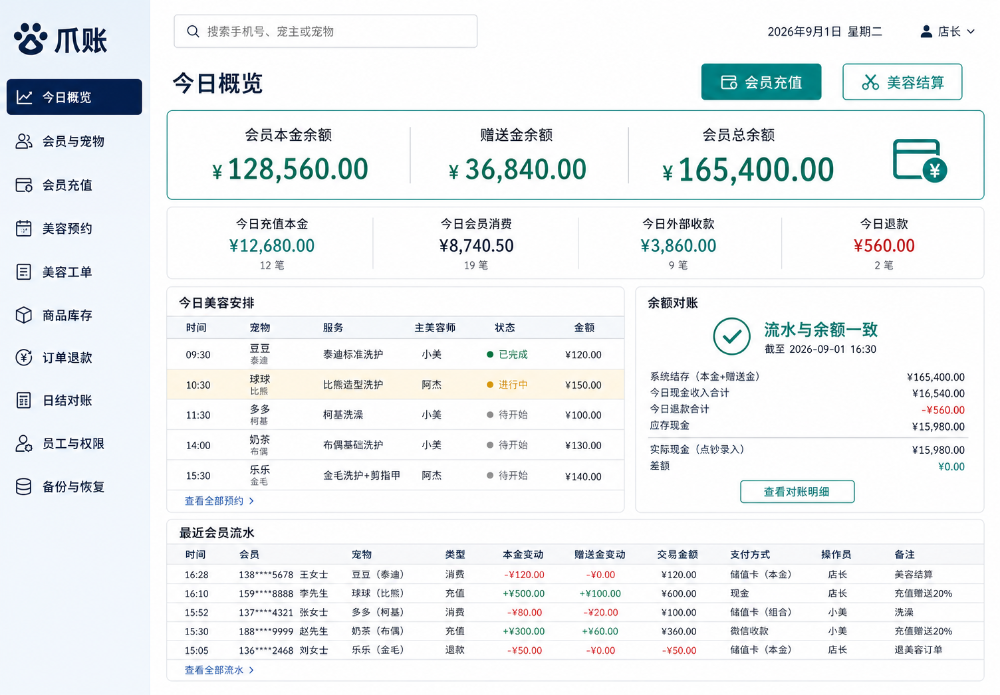
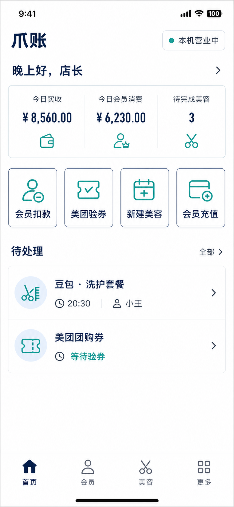

# PawLedger 爪账

面向单店宠物门店的离线优先管理系统。以会员储值余额和不可静默修改的资金流水为核心，同时覆盖宠物档案、美容履约、库存、团购对账、钱箱与员工权限。

[](https://github.com/scarabelhiroshi691-dev/pawledger/actions/workflows/ci.yml)


> 数据保留在店内电脑；断网仍可记账。手机店员端通过同一门店 Wi-Fi 连接电脑，不依赖云服务。



## 为什么做它

许多门店软件把重点放在营销入口，店长真正需要核对的余额、退款、赠送金、美容师归属和交接班却分散在不同页面。PawLedger 把“钱从哪里来、被谁以什么方式用掉、还能不能对上”放在首位。

## 已实现能力

| 业务 | 能力 |
| --- | --- |
| 会员储值 | 本金与赠送金分账，充值、消费、退款、冲正完整流水，余额并发保护 |
| 会员与宠物 | 宠主、宠物、会员卡、等级、折扣、积分与健康备注 |
| 美容服务 | 预约、工单、实际美容师、服务结算与美容师业绩 |
| 商品库存 | 商品、入库、库存流水、销售、退货与低库存提醒 |
| 团购对账 | 门店履约登记、订单防重、到账、退款与差额核对 |
| 门店经营 | 钱箱开班/关班、店内支出、现金长短款、日结与审计日志 |
| 权限与数据 | 店长/店员权限、账号停用、本地 SQLite、备份和恢复 |
| 手机店员端 | Android WebView 客户端，同一局域网完成收银与业务登记 |

美团真实核销仍在美团官方商家端完成。本项目不抓包、不复制 Cookie，也不模拟第三方官方客户端；PawLedger 只记录店内履约和结算对账。

## 快速开始

需要 [.NET 10 SDK](https://dotnet.microsoft.com/download/dotnet/10.0)。

```powershell
git clone https://github.com/scarabelhiroshi691-dev/pawledger.git
cd pawledger
dotnet restore PetShopManagement.slnx
dotnet run --project src/PetShop.Web
```

浏览器打开终端显示的本机地址，首次使用时创建店长账号。默认数据目录为 `%LOCALAPPDATA%\PawLedger`；也可以在启动前通过 `PETSHOP_DATA_DIR` 指定位置。

运行测试：

```powershell
dotnet test PetShopManagement.slnx
```

## Windows 与 Android

- Windows 打包脚本和启动辅助文件位于 `deploy/`。
- Android 工程位于 `mobile/PawLedgerAndroid`，需要 JDK 17 和 Android SDK 35，可用 Android Studio 打开。
- 手机与电脑必须连接同一个可信门店 Wi-Fi；电脑端只应在 Windows“专用网络”开放 TCP 5088。
- 当前 Android 工程是内部侧载客户端，不包含发布签名，也不建议直接上传应用商店。



## 项目结构

```text
src/PetShop.Domain          核心领域模型
src/PetShop.Application     应用层
src/PetShop.Infrastructure  基础设施
src/PetShop.Web             Razor Pages 门店应用
tests/                      领域与 Web 自动化测试
mobile/PawLedgerAndroid     Android 店员端
docs/                       产品、账务与使用文档
deploy/                     Windows 部署辅助脚本
```

产品与账务规则：

- [产品规格](docs/product-spec.md)
- [储值账务规则](docs/stored-value-ledger.md)
- [用户手册](docs/用户手册.md)
- [美团与手机端实施说明](docs/美团与手机端实施说明.md)
- [安全说明](SECURITY.md)
- [参与贡献](CONTRIBUTING.md)

## 当前边界与路线图

当前聚焦单店，不包含多店云同步、顾客小程序、在线预约、寄养、收银硬件或第三方平台非官方接入。后续优先级是发布签名 Android 包、可选局域网 HTTPS、导入工具与更完整的端到端回归测试。

## 授权

本仓库目前没有附加开源许可证，默认保留所有权利。公开可见不等于允许复制、修改、分发或商业使用；详情见 [COPYRIGHT.md](COPYRIGHT.md)。如果社区验证充分，再决定采用开放源代码许可证或商业双授权。
